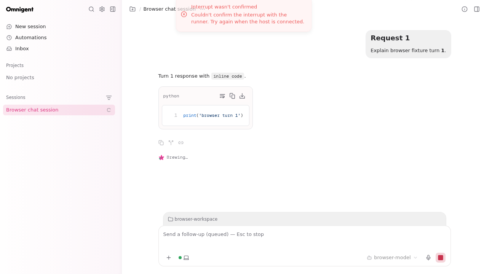

# When an interrupt cannot be confirmed

If the runner cannot acknowledge an Interrupt request, the web client shows
**Interrupt wasn't confirmed**, with the failure reason. Work may still be
running on the execution host. Reconnect that host before trying Interrupt again.

The screenshot uses a synthetic browser session and a scripted runner failure.
The live status indicator can continue updating after the notification; the
connection stays open. Messages already queued on the server remain pending
unless the runner confirms the interruption. An idle session with no runner has nothing to
interrupt.
