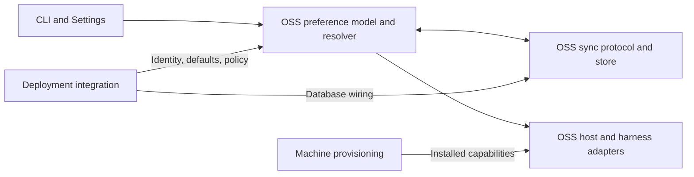
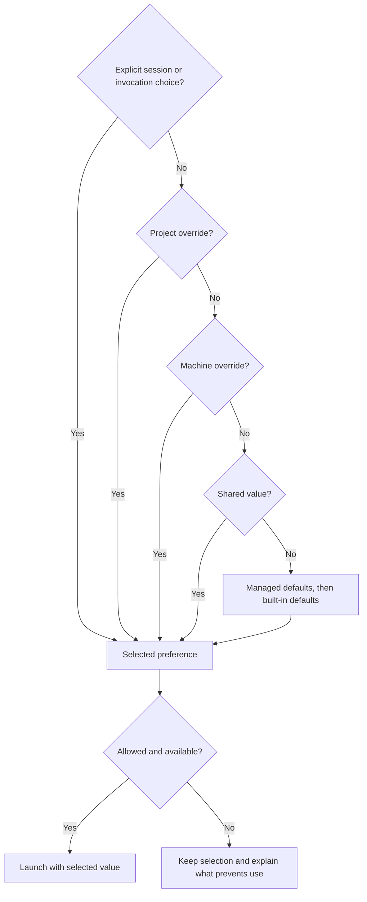
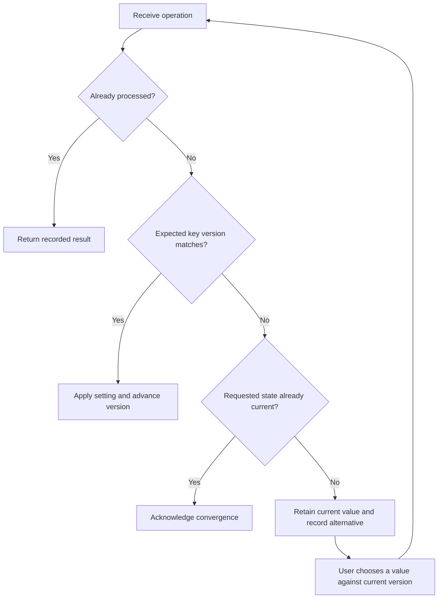
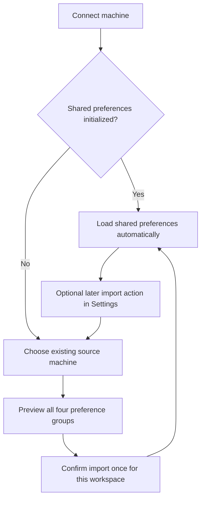

# Shared preferences across machines

Status: proposed implementation design, October 19, 2026. The user journeys
below are agreed; storage, protocol, migration, and UI details are proposals for
review. This document changes no runtime behavior.

People moving between a laptop and remote development machines should keep
their model, harness, startup arguments, and plugin preferences. They also need
to try a different harness in one session or keep a deliberate machine override.
Copying a configuration file cannot reliably distinguish these intentions.

This design supersedes the implementation approach in
[PR #9884](https://github.com/omnigent-ai/omnigent/pull/9884), inspected at
`4765b29d52d30dec036643000c173e05acbdc640`. The feature remains needed.

## Agreed user journeys

| When I… | I expect… |
| --- | --- |
| Open another machine in the same workspace | All four groups follow automatically: default model, default harness, harness startup arguments, and plugin enable/disable preferences. |
| Switch harnesses in a session | Only that session changes. Saving a machine or shared default is a separate action. |
| Set a machine override | That setting stays different until I remove the override; other settings keep syncing. Removing it resumes inheritance. |
| Select Pi where it is unavailable | Pi stays selected with an explanation. I can choose another harness for this session; there is no silent fallback. |
| Edit different settings while disconnected | Both changes survive when the machines reconnect. |
| Edit the same setting differently while disconnected | I see both choices and decide. The current shared value remains until resolution; the alternative is retained. |
| Switch workspaces | Each workspace has separate preferences. |
| Restart or update a managed launcher | My choices survive. Launcher defaults fill gaps; enforced policy can block use with an explanation without erasing my preference. |
| Lose connectivity on an existing machine | Cached preferences work with an offline indication. |
| Cannot load preferences on a fresh machine | After a bounded wait, I can Retry or Continue with temporary defaults. Temporary defaults never publish as shared preferences. |
| Set up shared preferences for the first time | I choose an existing source machine once and preview all four groups before import. |
| Open fresh remote machines afterwards | They inherit automatically, without repeating source selection. |
| Want to import again later | An explicit action repeats source selection and preview; automatic sync remains the default afterwards. |

Sharing preferences does not copy credentials, install harnesses/plugins, or
make a local path or model available remotely. Startup argument preferences
remain in scope even when they reference something missing on another machine.
An adapter must surface that problem without rewriting the saved preference.

## Proposed ownership

The portable behavior belongs in OSS Omnigent. Deployment integrations supply
identity, defaults, policy, provisioning, and managed storage wiring through
generic interfaces. They must not reimplement preference merging or conflicts.

| OSS Omnigent | Deployment integration |
| --- | --- |
| Shared, machine, and session scopes; effective-value explanation | Stable authenticated user/workspace identity |
| Import preview, reimport, offline state, conflicts, launch readiness | Launcher defaults and policy supplied separately from user preferences |
| Mutation protocol, persistence contract, generic SQL implementation | Managed database schema lifecycle, factory wiring, metrics |
| Native plugin preference adapters and unavailable-choice messages | Plugin/harness installation and deployment-specific adapters |
| Version negotiation and migration behavior | Runtime pins, startup handoff, rollout and real-machine verification |

## 1. Keep preference intent separate from effective configuration

Use one resolver across CLI launch, browser launch, host startup, and settings
inspection. Its input includes a required preference context: authenticated
authority, user ID, workspace ID, and installation ID. Derive authorization
from the server identity, never from client-supplied user IDs.

Partition the shared cache, pending mutations, and machine overrides by that
context. The installation ID scopes overrides and mutation provenance; it is
not part of the shared preference key. A server URL is a transport address,
not sufficient identity. A stable authority ID must disambiguate separate
servers, including self-hosted instances; a deployment must explicitly define
any aliases that share an authority. Do not load a different account's or
workspace's cache when authentication changes.

Proposed logical storage:

| Layer | Contents and write owner |
| --- | --- |
| Shared store | Per-user/workspace values, versions, initialization state, conflicts, import history. Written by authenticated preference operations. |
| Workspace cache and outbox | Last acknowledged state and durable pending operations. Owned by the sync client. |
| Machine overrides | Explicit per-workspace differences on this installation. Owned by scoped user actions. |
| Session/project choices | Existing session and project configuration; never published by observation. |
| Managed defaults and policy | Generated by deployment adapters, with a distinct source. Never treated as user edits. |
| Legacy local configuration | Existing unrelated settings and compatibility inputs; not a shared write queue. |

Do not write synchronized values back into the single global YAML file. That
file cannot hold two workspaces' shared state or distinguish a generated value
from a human choice. Reuse existing config parsing and harness canonicalization
inside the new resolver rather than implementing a second parser.

For scalar settings, propose this precedence; preserve existing project and
explicit invocation behavior:

Lists and native plugin settings need their existing semantics preserved:
startup argument lists are ordered, and explicit CLI arguments currently append
after configured base arguments. Resolve the base list through preference
layers, then apply invocation arguments as today. Native project/plugin policy
precedence remains explicit. Show both requested and effective plugin state
when mandatory policy overrides a user preference.

An ordinary session switch stays a session operation. Settings should label
the source of each effective value and offer **Save for this workspace**,
**Override on this machine**, and **Use shared value**. Exact CLI spelling and
layout remain review items. Shared edits should be the normal settings path;
legacy `config set --global` and direct YAML edits must not quietly acquire
remote side effects. Their compatibility behavior needs a documented adapter.

## 2. Sync explicit operations, with conflicts per setting

The first units of concurrency should be one model-default key, the default
harness, one complete argument list per canonical harness, and one boolean per
plugin identity. Preserve existing model-default distinctions, including the
separate OpenCode model setting. Do not merge argument arrays element by
element: ordering and paired flags matter.

Each operation carries a unique persistent ID, a typed key, an expected key
version, and a set/remove action. The server authorizes the scope and atomically
persists the accepted value or conflict. Retries return the recorded result.
Use server versions, not client clocks, to compare edits. Removing a value is a
versioned tombstone; it differs from `false`, an empty argument list, or a
machine override being removed.

Different keys can advance independently. For example, a laptop changing the
model and an offline machine changing the harness must preserve both changes.
Two different edits to the model create a conflict. Store each competing
alternative and its source; a third edit must not overwrite an earlier
unresolved alternative. A stale conflict-resolution request must refresh the
conflict instead of overwriting newer work.

Persist pending operations before sending. A delayed acknowledgement must not
clear a newer edit or deletion: acknowledge operation IDs, not the current
file contents. While offline, label local pending edits as unsynced; after a
conflict is discovered, use the current shared value unless an explicit
machine/session override applies. Retain the pending alternative for review.

Reuse the existing host tunnel, bounded payload validation, and ordered frame
handling where appropriate. Connected-host fanout reduces latency; reconnect
fetch and cross-replica revision checks establish convergence. Registration
must not depend on preference readiness, or a fresh machine could not become
reachable to complete setup.

Before implementation, specify limits and retention for operations, conflicts,
and tombstones. A client older than retained history must resync/rebase its
outbox explicitly; it must never resurrect a deleted value. Database writes
must serialize competing updates across server replicas, not just within a
Python process.

## 3. Initialize once, and make later imports explicit

Initialization is an explicit transaction per user/workspace. An empty snapshot
is a valid initialized state, so it needs a separate initialization marker.
The first connecting host must not automatically become the source of truth.

Preview only user-level values. Exclude session/project overrides, credentials,
and generated defaults with known provenance. Old files often lack provenance:
show their selected values as legacy values requiring review, rather than
claiming to infer which writer produced them. Preview pending conflicts and
missing capabilities separately from saved preference values.

Proposed reimport behavior: show a diff against the current shared state;
default to applying the displayed source values, with missing source entries
leaving shared settings unchanged. Clearing an existing shared entry requires
an explicit selection in the preview. Preserve machine overrides. Commit the
reviewed patch atomically against the preview revision; if it changed, refresh
the preview. Retain the prior snapshot so a restore can be reviewed as another
version-checked operation, preserving intervening edits.

If the source is offline, offer a clearly dated saved snapshot if one exists,
or ask the user to connect a source machine. A fresh machine may use temporary
defaults while setup is incomplete. Do not silently initialize from them.
The exact no-source flow and snapshot retention need design review.

## 4. Load preferences before starting new work

Expose `loading`, `ready`, `cached/offline`, `needs import`, and
`temporary defaults` states independently of host connection status. A proposed
initial loading budget is five elapsed seconds, configurable and testable.
This duration is a proposal, not an agreed product requirement.

On failure, an existing machine can use its matching workspace cache. A fresh
machine presents Retry and Continue with temporary defaults. Noninteractive
launches return a structured pending/unavailable result unless the caller
explicitly chooses temporary defaults; a managed host process can remain
connected while the UI completes this choice. All launch entry points need
the same readiness decision, including direct CLI launches without a daemon.

When connectivity returns, new sessions use the shared preferences. Do not
retroactively switch a running session or publish its temporary defaults.
Keep Pi selected when unavailable and offer an explained session-only change.
Model, argument-profile, and plugin availability should follow the same rule.

## 5. Adapt plugin preferences without copying installations

Current plugin inventory reads native settings; it is not a canonical writable
preference store. In particular, the effective enabled-plugin set loses the
difference between an explicit disable and an absent preference. Import must
read explicit booleans at user scope, not just copy the enabled inventory.

Use a typed identity containing the native ecosystem, stable source identity,
and plugin name. Reuse existing native identifiers where they are stable; a
display name or machine cache path is not enough. Do not assume Claude and
Codex entries with the same name are interchangeable. Native aliases and
cross-harness installation mappings need adapter-level tests.

Adapters translate requested preferences into native behavior while preserving
native project and managed-policy precedence. They must support workspace
isolation: two concurrent workspaces cannot overwrite one global native settings
file back and forth. Confirm whether each harness supports session-specific
configuration, or provide a scoped generated configuration. Inventory readers
must inspect that same effective context. This feasibility check is a gate for
the plugin implementation, not a reason to omit the fourth preference group.

Prefer Omnigent settings operations for shared writes. If native file edits are
adopted, track generated output separately and surface ambiguous edits for
review; never echo a generated projection back as a new shared preference.
Installation and executable content stay with the machine's provisioning tools.

## Migration and compatibility

Roll out behind a negotiated capability and a disabled deployment gate. Older
hosts retain their existing local behavior and appear as not participating;
they must not seed or overwrite the new shared state. Unknown keys from newer
clients must be preserved by older readers and rejected clearly by writers
that cannot interpret them. Do not change global rollout settings for tests.

After the first import, existing machines need an adoption step that records
their previous local values and removes only the adopted groups from legacy
effective precedence. Otherwise every old value would become an accidental
override and defeat automatic inheritance. Show discrepancies with shared
values, preserve alternatives, and let the user deliberately keep a machine
override. Fresh machines require no additional import.

Back up legacy state before migration. Managed launchers must stop rewriting
adopted preference groups and supply defaults/policy through their own layer.
Changing only the YAML lock would prevent concurrent writes, but would not
resolve which writer owns the value. Migrate non-shared settings independently.

Before enabling, define rollback behavior for clients and launchers that do not
understand the new layers. Disabling sync must retain cache, overrides, and
pending work; it must not convert generated output to authoritative legacy
preferences. Provide an explicit local export if an older runtime is needed.

## Replacement PR sequence

These are planned implementation slices, not PRs that already exist. All
behavior stays gated until the complete four-group user journey works.

| Slice | Repository owner | Depends on | Reviewable result |
| --- | --- | --- | --- |
| D: this design | OSS | None | Agreed journeys, proposed boundaries, review questions, acceptance criteria. |
| 1: preference layers and adapter contract | OSS | D review | Typed keys/context, one resolver, explicit shared/machine operations, source explanations, legacy migration contract, managed defaults/policy inputs. Preserve all existing consumers with the gate off. |
| 2: sync and conflict persistence | OSS | 1 | Per-setting versions, durable outbox, tombstones, retained conflicts, initialization/import transactions, reconnect and cross-replica convergence. |
| 3: native plugin adapters | OSS | 1 | Explicit enable/disable import and application, stable identities, workspace isolation, policy and availability explanations. |
| 4: complete user flows | OSS | 2, 3 | Source preview/reimport, scope controls, conflicts, offline/readiness handling across CLI/browser/native launch entry points. Update feature maps and demo the four-group journey. |
| 5: deployment integration and rollout | Integration repository | 1 contract; enable after 2–4 | Launcher defaults/policy adapter, managed database/identity wiring, runtime pins, real-machine startup and restart checks. Provisioning dependencies remain separately tracked. |

Slice 5 can be implemented in smaller backend and launcher PRs and developed
alongside slices 2–4 once the interfaces are reviewed. A design PR should not
close the feature request as delivered. Link replacement tracking before
closing #9884 as superseded by this design.

Carry forward #9884's bounded protocol handling, storage/transport plumbing,
ordered processing, writer coordination where still needed, and the invariant
that first-acknowledgement delays cannot erase intervening edits. Reuse or adapt
its two-host CLI/browser scenario. Replace full-snapshot last-writer-wins,
automatic seeding, URL-only client scope, and observation of global YAML as
evidence of a shared edit.

## Validation required before enabling

| Boundary | Evidence required |
| --- | --- |
| Resolution | Session/project/machine/shared/default precedence, empty/false/unset distinctions, all four groups, legacy gate-off behavior and other config consumers. |
| Protocol and persistence | Serialized frames through real routes/store; independent edits, conflicting edits, deletion, replay, delayed acknowledgement across restart, stale resolution, expired history, two replicas and authorization scope. |
| Local processes and UI | Real server plus two host processes; import, propagation, overrides, conflict choice, native plugin application, workspace/account isolation, offline cache, fresh-machine fallback and reimport. Cover every relevant feature-map entry point. |
| Native harness integration | Launch adapters with actual supported harness versions and isolated configuration; concurrent workspaces, missing Pi/model/plugin/profile, mandatory plugin policy, CLI argument ordering. |
| Managed deployment | Exact server/host/launcher pins and gates; source laptop or established remote machine to fresh remote machine; launcher restart/update; managed SQL/schema; cross-replica reconnect. |

Use input matrices at the lowest reliable layer, extend existing scenarios,
and reserve additional end-to-end tests for distinct process/native/browser
boundaries. Distinguish simulated delays from elapsed-time loading/offline
checks and local process tests from live managed-machine canaries.

Earlier tests on #9884 cover its existing local sync path and delayed-reply
fix. They do not establish this design's behavior. No new implementation,
live managed-machine check, or rollout is part of this documentation PR.

For a human acceptance pass after implementation: import from one existing
machine, open a fresh machine, and inspect all four groups. Change only a
session's harness; save and remove a machine override; create independent and
conflicting offline edits; switch workspaces; restart the managed launcher;
then reimport. At each step check both the selected value and its displayed
source. Verify missing Pi remains selected and temporary defaults never spread.

## Decisions still needed during technical review

1. Exact scope controls and legacy CLI/direct-file compatibility; existing
   machine adoption and rollback when provenance is unknown.
2. Plugin identity and per-workspace native configuration feasibility for each
   supported harness, including policy and edits made through native tools.
3. Import patch/clear/restore interactions, offline source selection, and
   retention limits for snapshots, conflicts, operation IDs, and tombstones.
4. Concrete schema, locking, protocol capability/version contract, authority
   identity, direct-CLI loading, and deployment gate wiring.

## Code references

Existing reusable behavior: [configuration merge](../omnigent/config.py),
[harness argument resolution](../omnigent/harness_startup_config.py),
[plugin inventory](../omnigent/host/plugins.py), and
[native plugin precedence](../omnigent/spec/skill_sources.py).
The sync implementation comparison is pinned to #9884's revision above;
the linked local files describe existing components, not this proposed feature.
